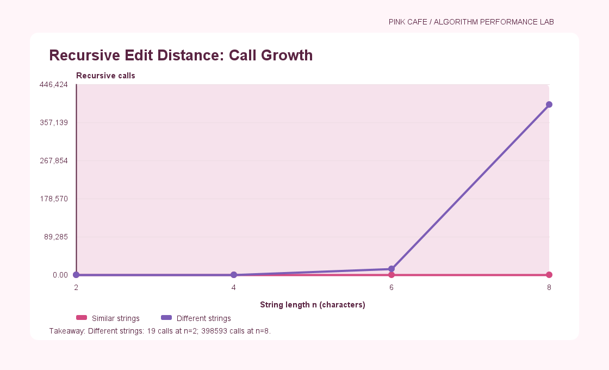
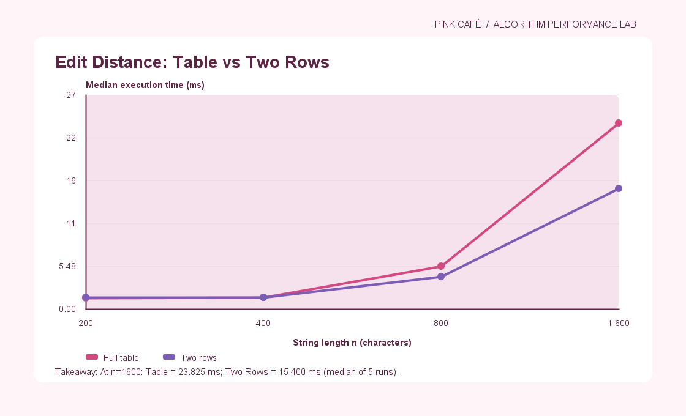
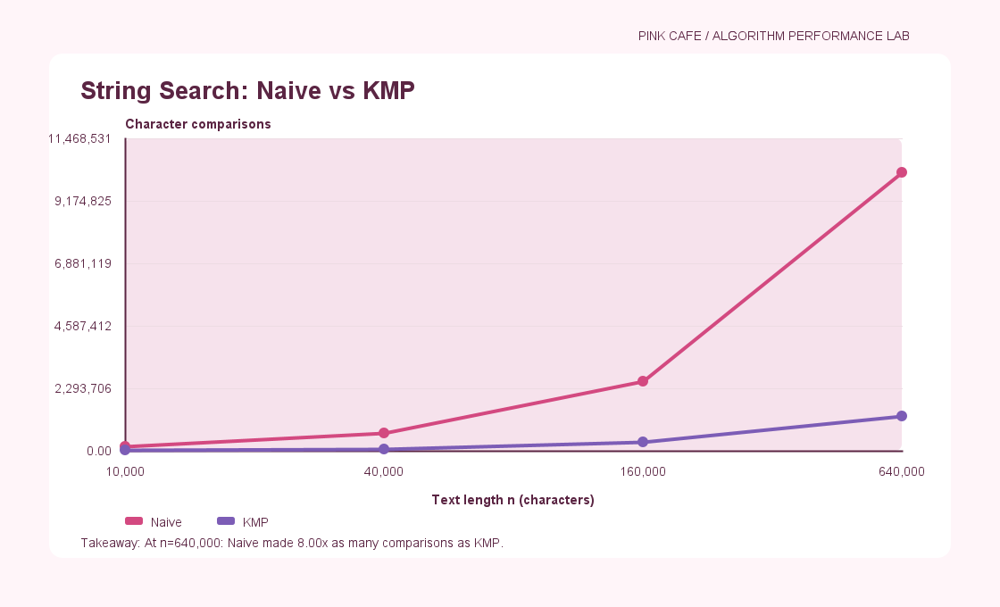

# Pink Café — Algorithm Performance Report

## 1. Experiment Design Card

### Question
How does input size affect the performance of Edit Distance,
Naive Search, and KMP in our Pink Café application?

### Sizes
- Recursive Edit Distance: 2, 4, 6, 8
- Table and Two Rows: 200, 400, 800, 1600
- String Search: 10000, 40000, 160000, 640000

These sizes show how algorithm performance changes as
input length increases. Smaller sizes are used for recursion
because it is much slower.

### Inputs
Edit Distance:
1. Similar strings — many matching characters.
2. Different strings — few matching characters,
   creating a difficult case for recursion.

String Search:
1. Random text — typical search behavior.
2. Repeated characters — a difficult case for Naive Search
   when the pattern almost matches at many positions.

A fixed random seed (42) will make inputs reproducible.

### Metrics
- Execution time in milliseconds, using the median of 5 runs.
- Recursive calls for Recursive Edit Distance.
- Calculated DP cells for Table and Two Rows.
- Character comparisons for Naive and KMP,
  including LPS preprocessing for KMP.

Counters are updated inside the algorithms.
Each run will be saved separately in results.csv.

### Prediction
Recursive Edit Distance will become much slower as input
size grows. Table and Two Rows will be more efficient.

Two Rows will use less memory than the full table.

KMP is expected to perform better than Naive Search
on difficult repeated-character inputs.

### Planned Plots
1. Recursive Edit Distance calls vs input size
   (logarithmic Y-axis).
2. Table vs Two Rows execution time (ms).
3. Naive/KMP comparison ratio vs text size.

Each plot will include a title, labeled axes,
units, and a short conclusion.

## 2. Results and Plots

The experiment was completed using five runs for each case.
Execution time and algorithm counters were recorded.

### Plot 1: Recursive Edit Distance

Recursive Edit Distance requires more calls as input
size increases, especially for different strings.

### Plot 2: Table vs Two Rows

At n = 1600, Table took 23.825 ms and
Two Rows took 15.400 ms in the measured case.
Both algorithms have O(n*m) time complexity,
but Two Rows uses less memory.

### Plot 3: Naive vs KMP

At n = 640000, Naive performed 8 times as many
character comparisons as KMP on repeated input.

## 3. Prediction vs Result

Edit Distance:
As expected, recursion becomes expensive on difficult
inputs. Table and Two Rows avoid repeated subproblems.

String Search:
KMP performed fewer comparisons on repeated input,
which supports our prediction.

## 4. Short Answers

### Which input made string search slowest?

The repeated-character input was the most difficult
case for Naive Search in terms of comparisons.
The algorithm repeatedly checks characters before
finding a mismatch. KMP uses its LPS array to
avoid unnecessary comparisons.

### How large an n could recursion handle?

We tested the recursive algorithm up to n = 8.
Larger difficult inputs would require many more
recursive calls because the algorithm repeats work.

### What do we gain and lose with Two Rows?

Two Rows saves memory because it stores only two
rows instead of the entire DP table.
Both methods have O(n*m) time complexity.
However, Two Rows does not preserve the full table,
so reconstructing the editing steps is harder.

### Which string search would you choose?

I would choose KMP for Pink Cafe.
It avoids repeated character comparisons and works
efficiently on long texts. Its disadvantage is
the additional LPS preprocessing step.

## 5. Time Measurements

We measured execution time using System.nanoTime()
and reported the median of five runs.

Execution time may change depending on the computer,
JVM optimization, and system load.

Therefore, we also used operation counters to
understand the algorithms more reliably.
